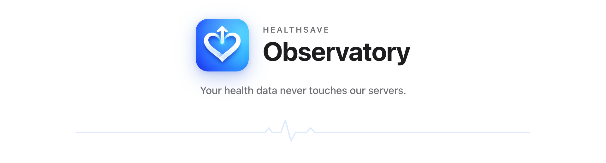
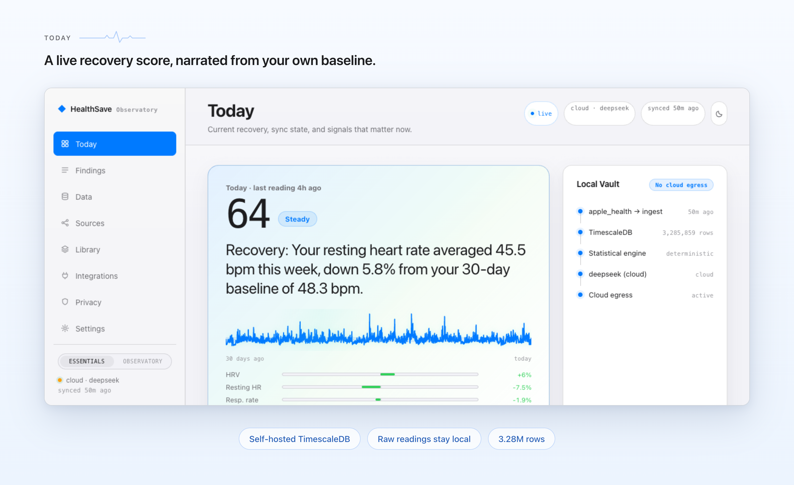
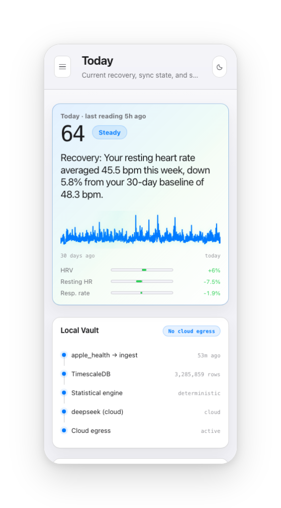
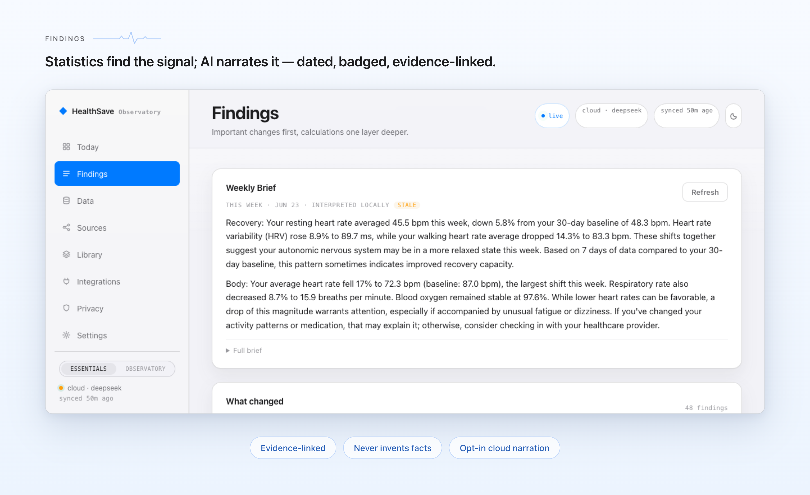
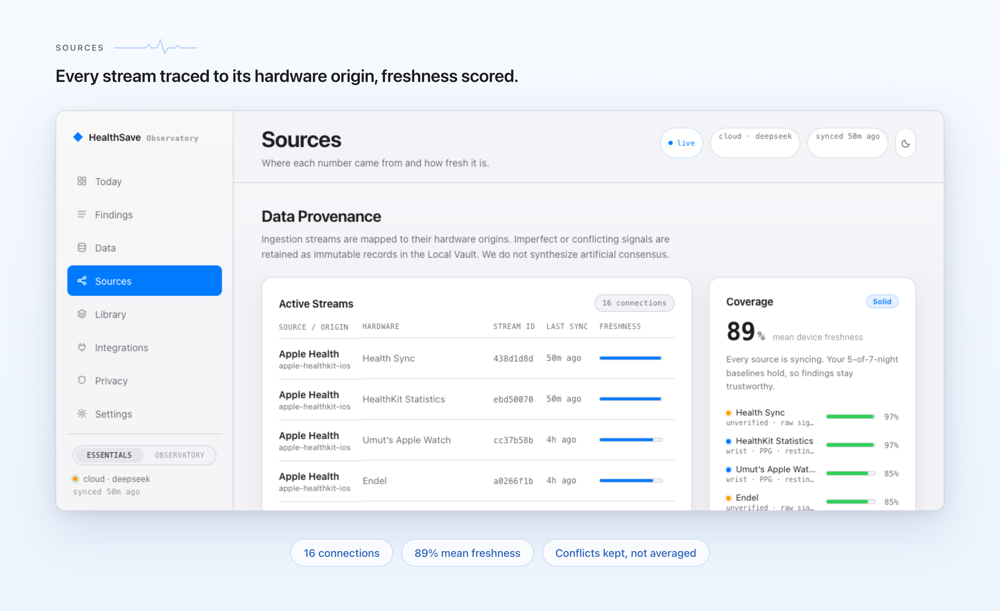
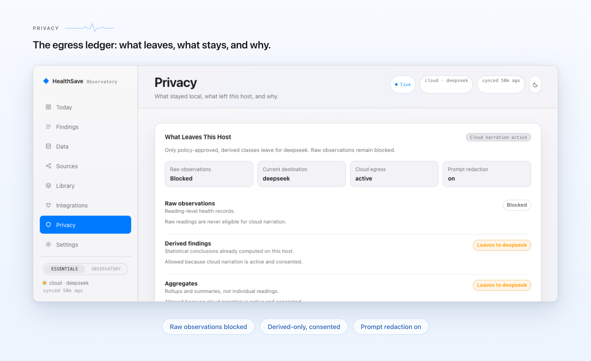
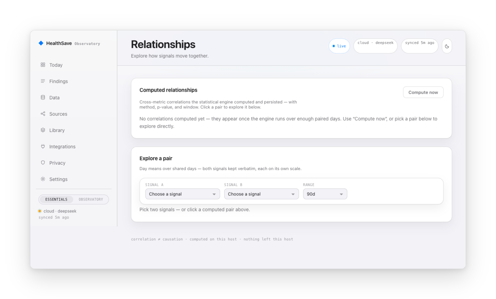
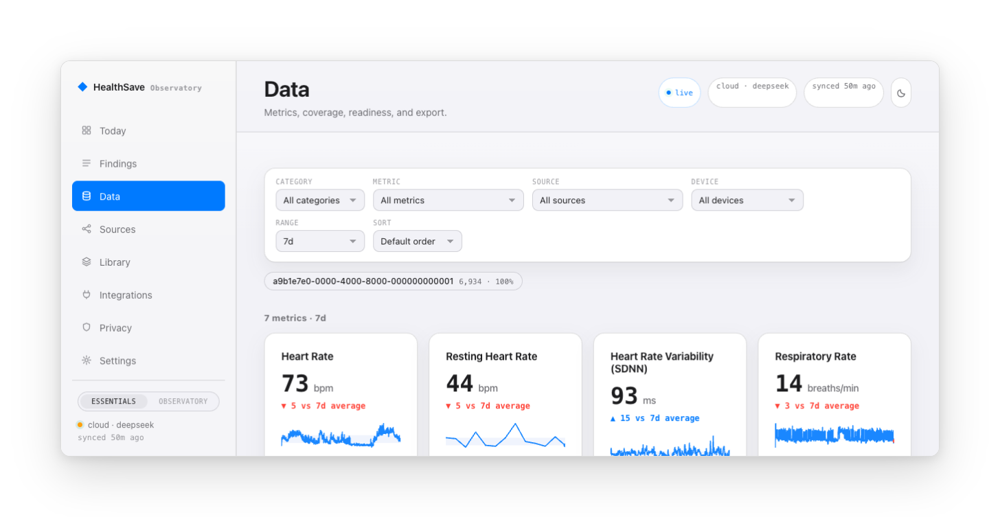

<p align="center">
  <picture>
    <source media="(prefers-color-scheme: dark)" srcset="docs/assets/github/hero-dark.png">
    
  </picture>
</p>

<p align="center">
  <a href="https://github.com/umutkeltek/healthsave-observatory/actions/workflows/ci.yml"></a>
  <a href="LICENSE"></a>
  <a href="https://www.docker.com/"></a>
  <a href="https://apps.apple.com/app/id6759843047"></a>
  <a href="https://healthsave.app"></a>
</p>

HealthSave Observatory is a self-hosted dashboard for your Apple Health data, synced from the HealthSave iPhone app. Your readings stay on a server you run. You get dashboards for everyday use, and you can send selected signals to Home Assistant.

Licensed under the Elastic License 2.0.

## What you get

- Apple Health on your own server, kept up to date from the HealthSave iPhone app.
- Dashboards for day-to-day use, and Grafana when you want to build your own charts.
- Findings computed from your measurements. An optional briefing can summarize those findings on the same machine. If you turn on cloud narration, only redacted, derived findings leave the server, and the Privacy view lists them.
- Home Assistant-friendly routes for the signals you choose to publish.
- Room for other inputs on the same record: early Whoop and Amazfit plugins, Garmin and Samsung importers, and planned Android Health Connect and HMAC-signed ingest.

The iPhone app also works without Observatory. Its on-device dashboard, trends, and CSV/JSON/PDF export do not need an account or this server. The app can write Home Assistant sensors on its own, too. Setup guides live at [healthsave.app](https://healthsave.app/).

## Dashboard

A short walkthrough of the dashboard:

<p align="center">
  <video src="docs/assets/observatory-showcase.mp4" controls poster="docs/assets/poster-showcase.jpg" preload="metadata" width="100%"></video>
</p>

<sub>[Open the walkthrough (33s)](docs/assets/observatory-showcase.mp4) if the player above does not load.</sub>

**Today.** A daily summary and a panel that shows the data is stored on your server.

<p align="center">
  <picture>
    <source media="(prefers-color-scheme: dark)" srcset="docs/assets/screenshots/panels/today-dark.png">
    
  </picture>
  &nbsp;&nbsp;
  
</p>

**Findings.** Changes computed from your measurements, with an optional briefing that cites those measurements.

<p align="center">
  <picture>
    <source media="(prefers-color-scheme: dark)" srcset="docs/assets/screenshots/panels/findings-dark.png">
    
  </picture>
</p>

**Sources.** Each stream keeps its device of origin and a freshness indicator. Conflicting readings stay as separate records.

<p align="center">
  <picture>
    <source media="(prefers-color-scheme: dark)" srcset="docs/assets/screenshots/panels/sources-dark.png">
    
  </picture>
</p>

**Privacy.** Raw readings stay on the server. Derived findings leave only while cloud narration is turned on.

<p align="center">
  <picture>
    <source media="(prefers-color-scheme: dark)" srcset="docs/assets/screenshots/panels/privacy-dark.png">
    
  </picture>
</p>

<details>
<summary><strong>More views</strong> — signal relationships, raw data explorer</summary>

| Relationships | Data explorer |
|:---:|:---:|
|  |  |

</details>

## Setup

### Requirements

- Docker Compose v2, installed and running.
- macOS, Linux, or Windows through WSL2. On Windows, install Docker Desktop, enable WSL integration for your Linux distro, then use the PowerShell handoff below or the Unix installer inside WSL2.
- Termux is not supported, because setup needs Docker Compose.
- Node.js, if you use `npm` or `npx`. The shell installer does not need Node already installed.
- A local Python install is not required to run Observatory. Development uses Python 3.12; see [Development](docs/development/dev-setup.md).

### Install

If Node.js is already available:

```bash
npm i -g healthsave
healthsave onboard
```

No global install:

```bash
npx healthsave
```

Server or clean-machine installer:

```bash
curl -fsSL https://raw.githubusercontent.com/umutkeltek/healthsave-observatory/main/install.sh | bash
```

Windows PowerShell, using WSL2:

```powershell
irm https://raw.githubusercontent.com/umutkeltek/healthsave-observatory/main/install.ps1 | iex
```

### Configuration

`healthsave onboard` opens a guided control center with arrow-key navigation:

- Basic setup and Advanced setup.
- Stack start/stop and optional layer toggles.
- Doctor/status checks, logs, and verification.
- CLI install and uninstall helpers.

Basic setup is the recommended first run. It generates local passwords and an API key, writes `.env`, creates `config.yaml` with local analysis on (anomalies, trends, correlations, and recovery; no AI model required), and starts the default services.

Advanced setup lets you choose passwords, the API key, local AI (Ollama) and its model, and optional layers.

Re-running setup keeps existing `.env` and `config.yaml` values unless you edit them. `healthsave pair` prints the API key and the server URL again.

### Services

A basic setup starts:

| Piece | Role |
|---|---|
| API | FastAPI service on port 8000. The iPhone app syncs here. |
| Database | TimescaleDB. Stores the canonical record. |
| Worker | Computes findings from stored readings. |
| Observatory web | Daily-use dashboard. |
| Grafana | Bundled charts and SQL dashboards. |

Optional layers, off until you enable them: local AI (Ollama), agents, MQTT, and Home Assistant.

Capture paths into that record:

- HealthSave iOS / Apple Health
- Wearable plugins and importers
- Planned Health Connect and generic ingest

### Connect the HealthSave iPhone app

1. Open [HealthSave](https://apps.apple.com/app/id6759843047) on iPhone.
2. Go to Settings -> Server Sync.
3. Set Server URL to the LAN URL printed by `healthsave pair`, for example `http://<server-lan-ip>:8000`.
4. Set the API key that `healthsave pair` prints.
5. Tap **Sync New Data**.

Point the app at that base URL only. The app sends Apple Health data to `POST /api/apple/batch` on the server. Do not use `localhost` from the phone. `localhost` would point at the phone itself.

`healthsave doctor` prints the URL to paste if you need it again.

Going straight to Home Assistant without running Observatory is also supported. The app writes `sensor.healthsave_*` entities over the Home Assistant REST API. See [Push Apple Health into Home Assistant](https://healthsave.app/guides/apple-health-to-home-assistant/).

### Checks

```bash
healthsave doctor
healthsave status
```

`doctor` checks platform tools, config files, service health, and URLs. `status` shows Docker state.

### Automation

Human setup should start with `healthsave onboard` or `npx healthsave`. Agents and CI should use named commands:

```bash
set -euo pipefail
healthsave setup basic --no-input
healthsave doctor --json
```

### Manual checkout

```bash
git clone https://github.com/umutkeltek/healthsave-observatory.git
cd healthsave-observatory
./healthsave onboard
```

### Command lifecycle

- npm package name: `healthsave`
- global install path: `npm i -g healthsave`, then `healthsave onboard`
- no-install path: `npx healthsave`
- repo-local fallback: `./healthsave onboard`
- local wrapper install: `./healthsave install-cli`
- local wrapper uninstall: `./healthsave uninstall-cli`
- npm uninstall removes only the npm bootstrapper, not the checkout, containers, volumes, config, or health data
- Homebrew formula template: `packaging/homebrew/healthsave.rb.template`

## Documentation

- [Overview](docs/overview.md) - product layers, data flow, and what ships today.
- [Zero To Ready](docs/zero-to-ready.md) - clean-machine path from install to synced iOS data.
- [Quick Start](docs/quick-start.md) - short setup path and health checks.
- [Connect HealthSave](docs/connect-healthsave.md) - pair the iOS app with the self-hosted backend.
- [Capture sources](docs/capture/index.md) - Apple Health, plugins, importers, and planned ingest paths.
- [Observatory web](docs/surfaces/observatory-web.md) - primary daily-use product surface.
- [Grafana](docs/surfaces/grafana.md) - bundled SQL-backed power-user dashboard.
- [Web vs Grafana](docs/surfaces/web-vs-grafana.md) - product surface versus raw dashboard boundary.
- [Home Assistant & MQTT](docs/integrations/home-assistant.md) - bridge HealthSave signals into Home Assistant.
- [API](docs/api/index.md) - stable ingest and evolving read/query APIs.
- [Deployment](docs/operations/deployment.md) - run on a laptop, VM, NAS, Proxmox VM, or homelab box.
- [CLI distribution](docs/operations/cli-distribution.md) - npm/npx, installers, repo-local launcher, and Homebrew release shape.
- [Development](docs/development/dev-setup.md) - local development and verification.

Product-side documentation (iOS app setup, metric reference, export guides, troubleshooting,
and free in-browser tools) lives at **[healthsave.app](https://healthsave.app/)** —
[export guide](https://healthsave.app/export-health-data.html) ·
[metric reference](https://healthsave.app/metrics/) ·
[Apple Health XML to CSV converter](https://healthsave.app/tools/health-export-to-csv/) (free, runs in your browser).

## License

Licensed under the Elastic License 2.0. Protocol and SDK components may carry separate Apache-2.0 licensing where noted. See [LICENSING.md](LICENSING.md).
