<p align="center">
  <picture>
    <source media="(prefers-color-scheme: dark)" srcset="docs/assets/github/hero-dark.png">
    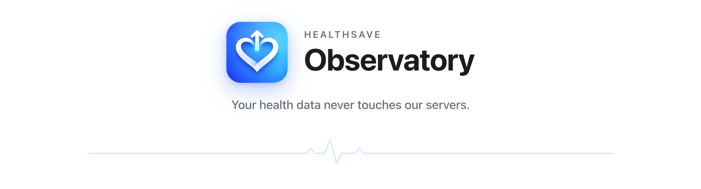
  </picture>
</p>

<h3 align="center">Your Apple Health data, on a server you own.</h3>

<p align="center">
  A self-hosted dashboard for the <a href="https://apps.apple.com/app/id6759843047">HealthSave</a> iPhone app.<br>
  Sleep, activity, blood tests and a whole year of records, each read against your own baseline.<br>
  No HealthSave account. Nothing leaves your server unless you choose.
</p>

<p align="center">
  <a href="https://github.com/umutkeltek/healthsave-observatory/releases/latest"></a>
  <a href="https://github.com/umutkeltek/healthsave-observatory/actions/workflows/ci.yml"></a>
  <a href="LICENSING.md"></a>
  <a href="docs/operations/deployment.md"></a>
  <a href="https://apps.apple.com/app/id6759843047"></a>
</p>

<p align="center">
  <a href="#quick-start"><b>Quick start</b></a> &nbsp;·&nbsp;
  <a href="#a-look-around"><b>Tour</b></a> &nbsp;·&nbsp;
  <a href="#whats-inside"><b>What's inside</b></a> &nbsp;·&nbsp;
  <a href="#how-it-works"><b>How it works</b></a> &nbsp;·&nbsp;
  <a href="#privacy"><b>Privacy</b></a> &nbsp;·&nbsp;
  <a href="#setup"><b>Setup</b></a> &nbsp;·&nbsp;
  <a href="#documentation"><b>Docs</b></a>
</p>

<p align="center">
  <picture>
    <source media="(prefers-color-scheme: dark)" srcset="docs/assets/readme/hero-today-dark.png">
    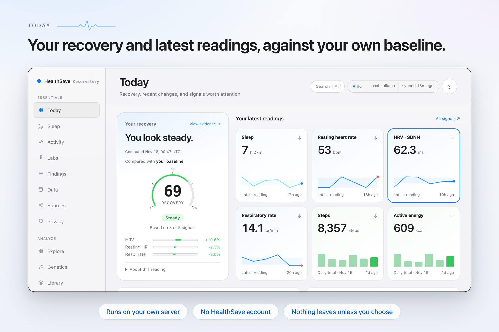
  </picture>
</p>

## Why Observatory

<table>
  <tr>
    <td width="33%" valign="top">
      <b>Yours to keep</b><br><br>
      Your readings live in a database on your own machine: a laptop, a NAS, a mini PC or a home server. There is no HealthSave account and no cloud service in between.
    </td>
    <td width="33%" valign="top">
      <b>Read against you</b><br><br>
      Each number is compared with your own recent history, not with a population average. Every finding shows the data and the calculation behind it.
    </td>
    <td width="33%" valign="top">
      <b>Nothing blended</b><br><br>
      Readings from two devices are never averaged into one number. Days with no data show as gaps instead of being filled in.
    </td>
  </tr>
</table>

## Free, with one optional paid plan

Everything in this repository is free to run, including backup, restore and updates, and nothing free will move behind a licence.

If you want your backups looked after, **Observatory Care** costs $99 a year or $9 a month. It adds encrypted backups on a schedule, copied to storage you choose (a NAS, S3 or Backblaze B2, through rclone), restore drills that prove a backup opens, and a one-command rollback after an update. The backups never reach HealthSave, and the licence is checked on your own server, offline. [See Care](https://healthsave.app/pricing/?utm_source=observatory_readme#care) · [What it adds](docs/operations/observatory-care.md)

## Quick start

You need [Docker Compose v2](https://docs.docker.com/compose/install/) on macOS, Linux, or Windows through WSL2.

```bash
npx healthsave
```

Pick **Basic setup**. It creates the passwords and an API key, then starts the default services. After that:

1. Run `healthsave pair`. It prints your server's address, the API key and a QR code.
2. Scan the QR code with the iPhone Camera. HealthSave opens Server Sync with the address and key filled in. Tap **Sync Latest Changes**, or **Backfill Past Data** for your whole history.
3. On the server, open **http://localhost:4173**. `healthsave pair` also shows the dashboard password.

Observatory is free. Sending by hand is free too: the Server Sync screen that opens after you scan the QR code works without Pro. Automatic sync (in the background and each time you open the app) needs HealthSave Pro, a one-time purchase in the iPhone app; with Pro you can also open Server Sync from Settings at any time. Without Pro, scan the code again to send more. [What is free and what needs Pro](docs/connect-healthsave.md#free-and-pro). Other ways to install are under [Setup](#setup).

## A look around

<table>
  <tr>
    <td width="50%" valign="top">
      <b>Sleep</b><br>
      Every night by stage, with consistency, efficiency and sleep debt.<br><br>
      <picture>
        <source media="(prefers-color-scheme: dark)" srcset="docs/assets/readme/sleep-dark.png">
        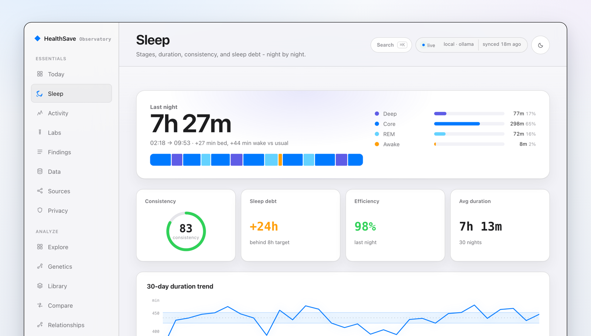
      </picture>
    </td>
    <td width="50%" valign="top">
      <b>Activity</b><br>
      Steps, exercise, energy and walking heart rate next to your 7-day average.<br><br>
      <picture>
        <source media="(prefers-color-scheme: dark)" srcset="docs/assets/readme/activity-dark.png">
        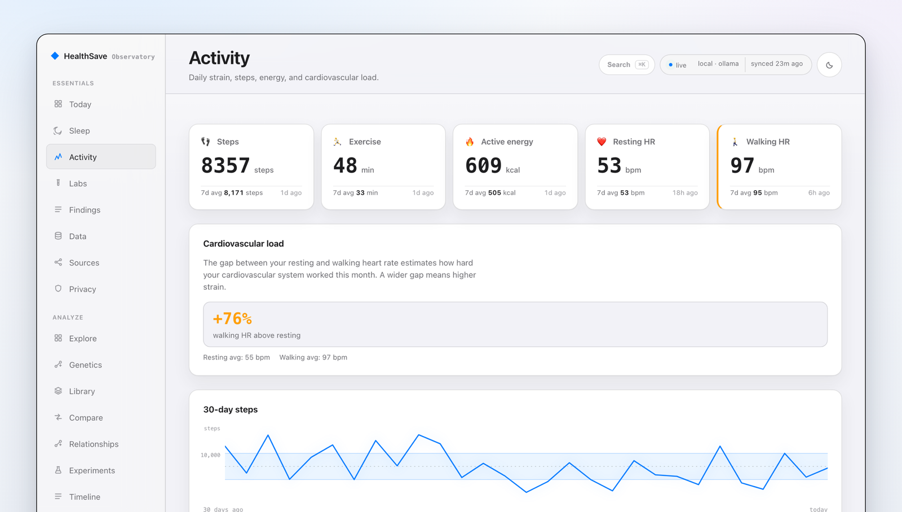
      </picture>
    </td>
  </tr>
  <tr>
    <td width="50%" valign="top">
      <b>Blood tests</b><br>
      Each marker against the range your lab printed and your own past results. Two labs stay side by side.<br><br>
      <picture>
        <source media="(prefers-color-scheme: dark)" srcset="docs/assets/readme/labs-dark.png">
        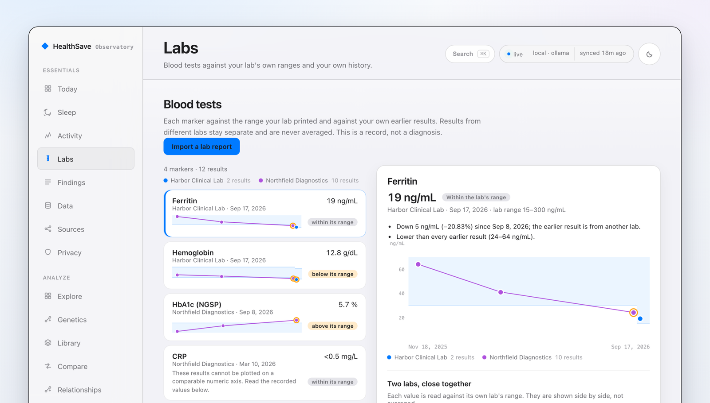
      </picture>
    </td>
    <td width="50%" valign="top">
      <b>Year in Health</b><br>
      A year on one page: which days hold data, and which devices sent it. The share card shows no personal numbers unless you add them.<br><br>
      <picture>
        <source media="(prefers-color-scheme: dark)" srcset="docs/assets/readme/year-dark.png">
        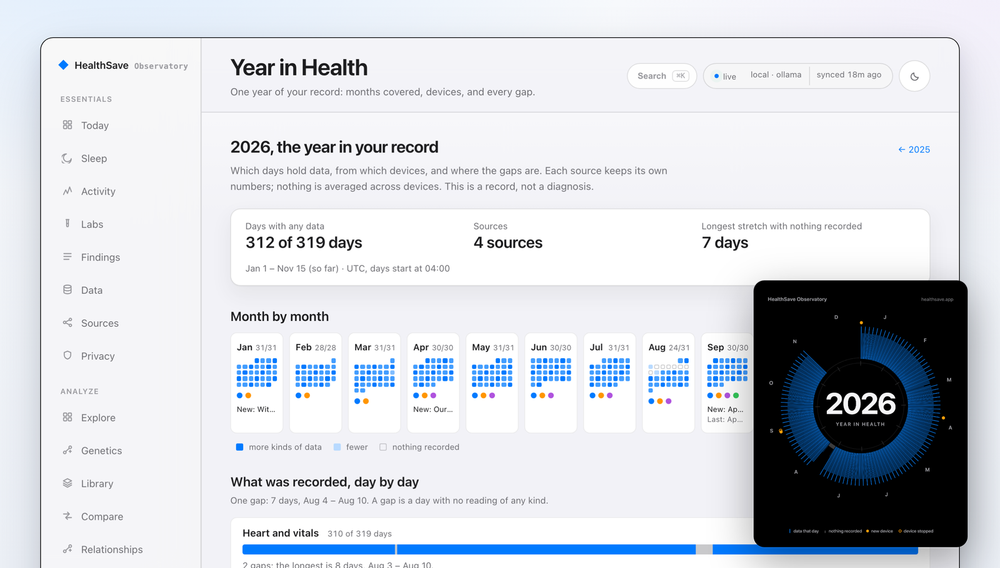
      </picture>
    </td>
  </tr>
  <tr>
    <td width="50%" valign="top">
      <b>Findings</b><br>
      Trends, outliers and links between signals, computed from your data, each with its numbers and limits.<br><br>
      <picture>
        <source media="(prefers-color-scheme: dark)" srcset="docs/assets/readme/findings-dark.png">
        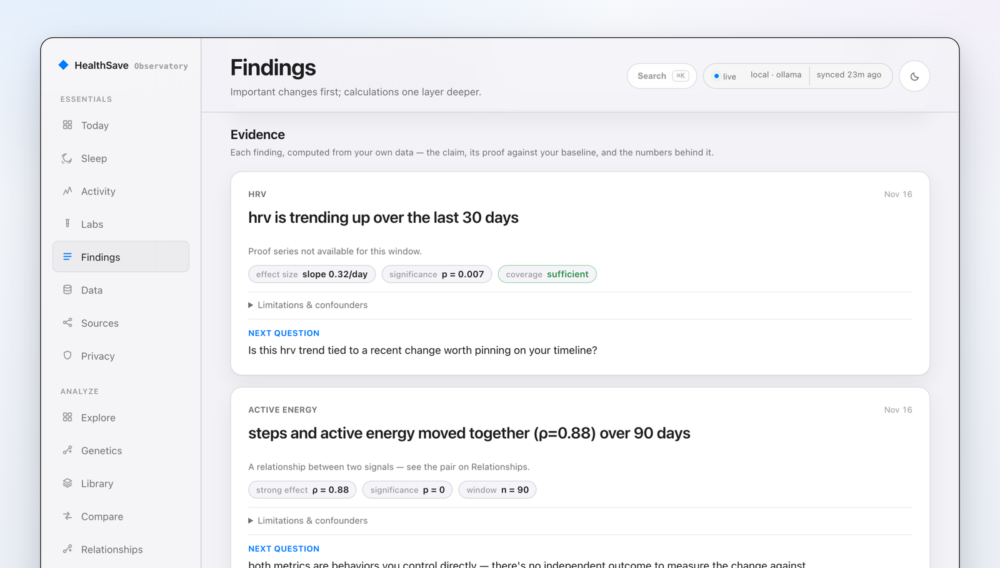
      </picture>
    </td>
    <td width="50%" valign="top">
      <b>Privacy</b><br>
      What stays on the server, what may leave it, and why.<br><br>
      <picture>
        <source media="(prefers-color-scheme: dark)" srcset="docs/assets/readme/privacy-dark.png">
        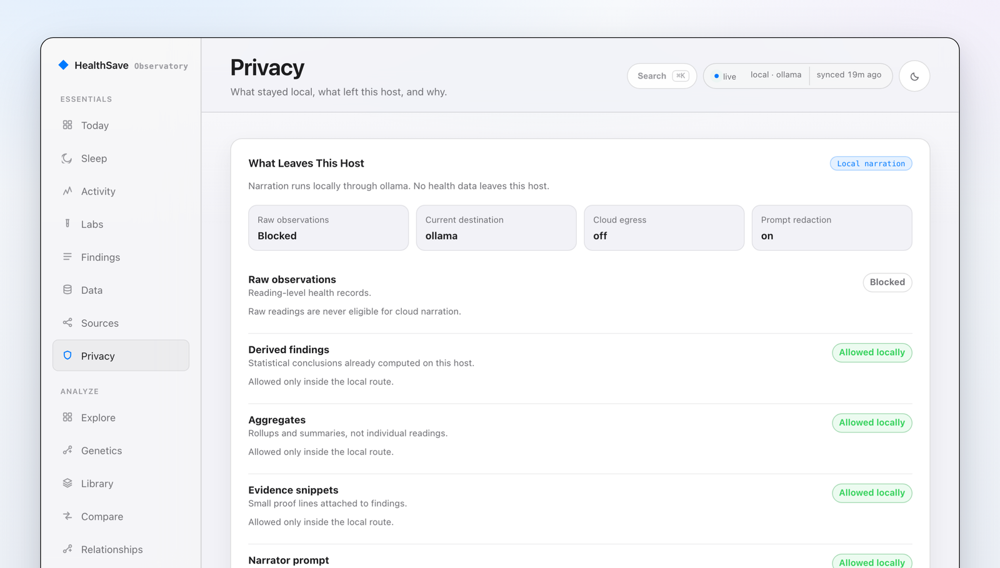
      </picture>
    </td>
  </tr>
  <tr>
    <td width="50%" valign="top">
      <b>Explore</b><br>
      Build your own panels from any signals, then save the view or pin it to Today.<br><br>
      <picture>
        <source media="(prefers-color-scheme: dark)" srcset="docs/assets/readme/explore-dark.png">
        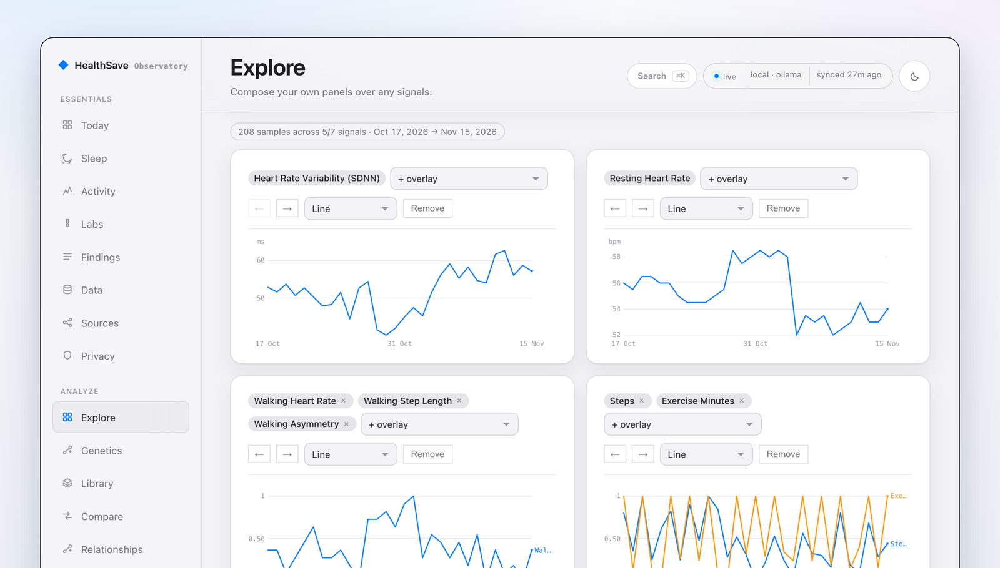
      </picture>
    </td>
    <td width="50%" valign="top">
      <b>Compare</b><br>
      Two periods, sources or devices side by side, each kept as its own series.<br><br>
      <picture>
        <source media="(prefers-color-scheme: dark)" srcset="docs/assets/readme/compare-dark.png">
        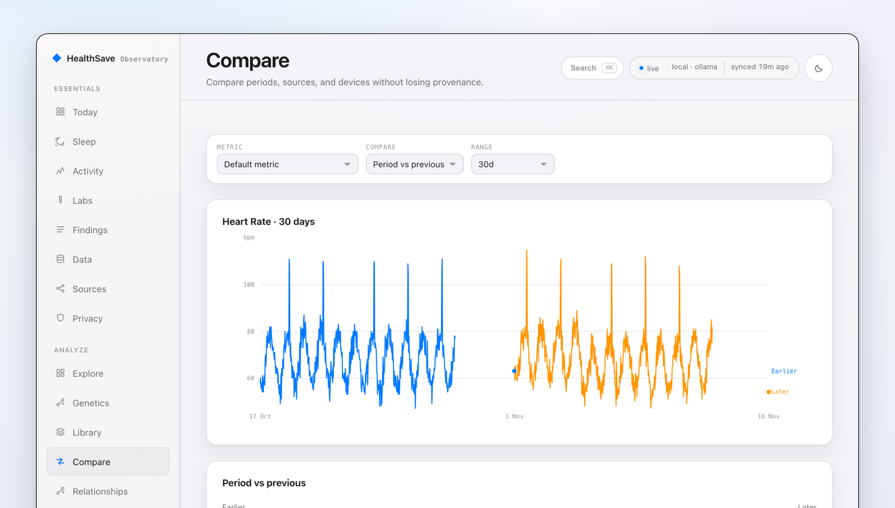
      </picture>
    </td>
  </tr>
</table>

**On your phone, too.** Every screen works at phone width, in light and dark.

<p align="center">
  <picture>
    <source media="(prefers-color-scheme: dark)" srcset="docs/assets/readme/phones-dark.png">
    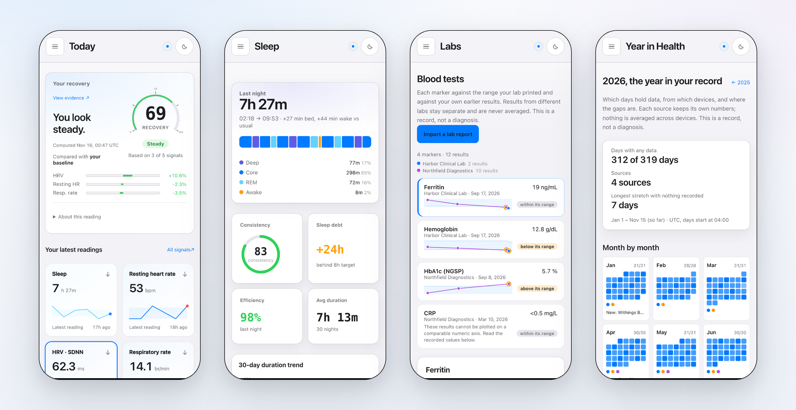
  </picture>
</p>

<sub>All screenshots use a synthetic year made by <code>scripts/seed_synthetic_year.py</code>. None of it is a real person's data.</sub>

## What's inside

### Screens

| Group | Screens |
|---|---|
| **Essentials** | Today · Sleep · Activity · Labs · Findings · Data · Sources · Privacy |
| **Analyze** | Explore · Genetics · Library · Compare · Relationships · Experiments · Timeline · Year in Health |
| **Manage** | Integrations · Intelligence (the optional AI brief) · Settings |

Press <kbd>⌘</kbd> <kbd>K</kbd> (<kbd>Ctrl</kbd> <kbd>K</kbd> elsewhere) to jump to a screen or to any of about 190 signals.

### Data in

| Source | How it connects | Status |
|---|---|---|
| **Apple Health**: Apple Watch, iPhone, and apps that write to it, such as Oura, Withings and many Garmin watches | [HealthSave](https://apps.apple.com/app/id6759843047) iPhone app | Ready |
| **Whoop**, **Amazfit / Zepp** | Direct plugins ([guide](docs/capture/plugins-whoop-amazfit.md)) | Early |
| **Garmin Connect**, **Samsung / Huawei Health** | File importers ([guide](docs/capture/importers-garmin-samsung.md)) | Ready |
| **Polar**, **Google Health** | Direct plugins ([`plugins/sources`](plugins/sources)) | Experimental |
| **Blood tests** | `healthsave labs import FILE.csv` ([guide](docs/capture/labs-csv.md)); CSV and PDF upload with review in the web app | Ready; web upload in the next release |
| **Genetic evidence**: 23andMe or Ancestry TXT/TSV, VCF | Matched against public ClinVar data on your own server ([guide](docs/capture/genetic-evidence.md)) | Next release |
| **Android Health Connect** | HealthSave for Android, same data format | In development |
| **Any device, signed webhook** | Generic ingest API ([roadmap](docs/capture/roadmap-android-webhooks.md)) | Planned |

"Next release" means the feature is on `main` but not yet in a tagged release. Installs follow tags.

### Data out, only where you send it

- **Your own AI.** `healthsave mcp` prints one line that connects Claude Code or Claude Desktop to your server, read-only. Ask "how did I sleep this year?" and it answers from your record. See [Give your AI a body](docs/mcp.md).
- **Home Assistant and MQTT.** Publish the signals you pick as sensors. See [Home Assistant & MQTT](docs/integrations/home-assistant.md).
- **Grafana.** Bundled, for your own SQL charts. See [Grafana](docs/surfaces/grafana.md).
- **API and export.** A read API under `/api/v2`, plus CSV and JSON export. See [API](docs/api/index.md).
- **A weekly brief, if you want one.** A local model (Ollama) can summarize findings that were already computed. A cloud model is used only if you turn it on and agree, and it receives derived findings only. See [Local LLM](docs/operations/local-llm.md).

## How it works

<p align="center">
  <picture>
    <source media="(prefers-color-scheme: dark)" srcset="docs/assets/readme/how-it-works-dark.png">
    
  </picture>
</p>

The API stores every reading with the device it came from. The worker computes findings with plain statistics: trends, outliers, links between signals, and a recovery score. No AI model is needed for any of it. The web app, Grafana and the routes you add all read from that one record.

## Privacy

| What | Where it goes |
|---|---|
| **Raw readings** | Stay in your database. The AI brief never receives them, local or cloud. |
| **Findings and summaries** | Computed on your server. A cloud model sees them only if you turn cloud narration on and agree, and the prompt is redacted first. The Privacy screen lists what left and why. |
| **Home Assistant, MQTT, exports, MCP** | Only the routes you set up, to the places you choose. |
| **HealthSave's own servers** | Never receive your health data. Observatory needs no HealthSave account and has no analytics. |

More detail: [Privacy and egress](docs/concepts/privacy-and-egress.md) and [Security](docs/operations/security.md).

The iPhone app also works without Observatory. Its dashboard, trends, and CSV, JSON and PDF export need no server, and it can write Home Assistant sensors directly. See [healthsave.app](https://healthsave.app/).

## Setup

### Requirements

- Docker Compose v2, installed and running.
- macOS, Linux, or Windows through WSL2. On Windows, install Docker Desktop and turn on WSL integration for your Linux distro.
- Node.js only if you use `npm` or `npx`. The shell installer does not need it.
- No local Python install. Development uses Python 3.12; see [Development](docs/development/dev-setup.md).

Pre-built images for `linux/amd64` and `linux/arm64` are signed with cosign. It runs on a laptop, a VM, a NAS, a Proxmox VM or a home server; see [Deployment](docs/operations/deployment.md).

### Install

With Node.js:

```bash
npm i -g healthsave
healthsave onboard
```

No global install:

```bash
npx healthsave
```

Server or clean machine:

```bash
curl -fsSL https://raw.githubusercontent.com/umutkeltek/healthsave-observatory/main/install.sh | bash
```

Windows PowerShell (hands off to WSL2):

```powershell
irm https://raw.githubusercontent.com/umutkeltek/healthsave-observatory/main/install.ps1 | iex
```

From a checkout:

```bash
git clone https://github.com/umutkeltek/healthsave-observatory.git
cd healthsave-observatory
./healthsave onboard
```

Every path opens the same control center: arrow keys and Enter. It covers setup, starting and stopping the stack, optional layers, checks, logs, and installing the CLI.

- **Basic setup** (recommended first). Generates passwords and an API key, writes `.env`, creates `config.yaml` with local analysis on (anomalies, trends, correlations and recovery; no AI model needed), and starts the default services.
- **Advanced setup.** Lets you choose the passwords, the API key, a local AI model (Ollama) and the optional layers. It checks your RAM and GPU and suggests a model.

Running setup again keeps your existing `.env` and `config.yaml` values.

### What runs

| Service | What it does | Address |
|---|---|---|
| Observatory web | The dashboard | `http://localhost:4173` |
| API | Receives syncs from the iPhone app; serves the read API | `http://<server>:8000` |
| Database | TimescaleDB, the one record | local only |
| Worker | Computes findings from stored readings | n/a |
| Grafana | Bundled SQL charts | `http://localhost:3000` |

Optional layers stay off until you turn them on: local AI (`healthsave up --ai`), agents (`--agents`), an MQTT broker (`--mqtt`) and the Home Assistant bridge (`--home-assistant`).

### Connect the iPhone app

`healthsave pair` shows the server address, the API key, a QR code (when `qrencode` is installed) and the dashboard password.

- **With the QR code:** scan it with the iPhone Camera. HealthSave opens Server Sync with everything filled in. This works without Pro.
- **By typing it in (needs Pro):** in HealthSave, open **Settings → Server Sync**, enter the address and the API key, then tap **Sync Latest Changes**.

Use the server's network address, for example `http://192.168.1.20:8000`. Do not use `localhost` on the phone: there it means the phone itself. The app posts to `POST /api/apple/batch`; give it the base address only. Full guide: [Connect HealthSave](docs/connect-healthsave.md).

### Check, update, back up

```bash
healthsave doctor        # platform, config, services and addresses
healthsave status        # what is running
healthsave update        # move to the newest release; takes a backup first
healthsave backup        # database, .env and config.yaml in one file
healthsave restore FILE  # takes a safety backup first
```

Everything above is free. [Observatory Care](docs/operations/observatory-care.md), an optional licence, adds encrypted off-site backups, restore drills and one-command rollback.

To reach the dashboard away from home without opening a port on your router, use the Tailscale layer: [Remote access](docs/operations/remote-access.md). Behind your own proxy: [Reverse proxy](docs/operations/reverse-proxy.md).

<details>
<summary><b>Scripts, CI and the CLI lifecycle</b></summary>

People should start with `healthsave onboard` or `npx healthsave`. Scripts and CI should use named commands:

```bash
set -euo pipefail
healthsave setup basic --no-input
healthsave doctor --json
```

- npm package: `healthsave`. Global install: `npm i -g healthsave`, then `healthsave onboard`. No install: `npx healthsave`.
- From a checkout: `./healthsave onboard`. Put that checkout's command on your PATH with `./healthsave install-cli`; remove it with `./healthsave uninstall-cli`.
- Uninstalling the npm package removes only the bootstrapper. Your checkout, containers, volumes, config and health data stay.
- Homebrew formula template: `packaging/homebrew/healthsave.rb.template`.
- More: [CLI distribution](docs/operations/cli-distribution.md).

</details>

## Documentation

| Start | Use | Connect | Run |
|---|---|---|---|
| [Overview](docs/overview.md) | [Observatory web](docs/surfaces/observatory-web.md) | [Capture sources](docs/capture/index.md) | [Deployment](docs/operations/deployment.md) |
| [Zero to ready](docs/zero-to-ready.md) | [Findings & Body Briefs](docs/surfaces/findings-and-body-briefs.md) | [Home Assistant & MQTT](docs/integrations/home-assistant.md) | [Backups & migrations](docs/operations/backup-and-migrations.md) |
| [Quick start](docs/quick-start.md) | [Grafana](docs/surfaces/grafana.md) | [Give your AI a body (MCP)](docs/mcp.md) | [Remote access](docs/operations/remote-access.md) |
| [Connect HealthSave](docs/connect-healthsave.md) | [Web vs Grafana](docs/surfaces/web-vs-grafana.md) | [API](docs/api/index.md) | [Participants](docs/operations/participants.md) |
| [Troubleshooting](docs/operations/troubleshooting.md) | [Privacy and egress](docs/concepts/privacy-and-egress.md) | [Local LLM](docs/operations/local-llm.md) | [Development](docs/development/dev-setup.md) |

Guides for the iPhone app, a metric reference and free in-browser tools are at **[healthsave.app](https://healthsave.app/)**: [Observatory](https://healthsave.app/observatory/) · [export guide](https://healthsave.app/export-health-data.html) · [metric reference](https://healthsave.app/metrics/) · [Apple Health XML to CSV converter](https://healthsave.app/tools/health-export-to-csv/), which runs in your browser.

Contributing: [CONTRIBUTING.md](CONTRIBUTING.md) · Security reports: [SECURITY.md](SECURITY.md) · Releases: [CHANGELOG.md](CHANGELOG.md)

## License

The core server is licensed under the Elastic License 2.0: you can read, run, modify and self-host it, but not offer it to others as a hosted or managed service. The protocol, contracts and plugin SDK are licensed under Apache-2.0. See [LICENSING.md](LICENSING.md).
